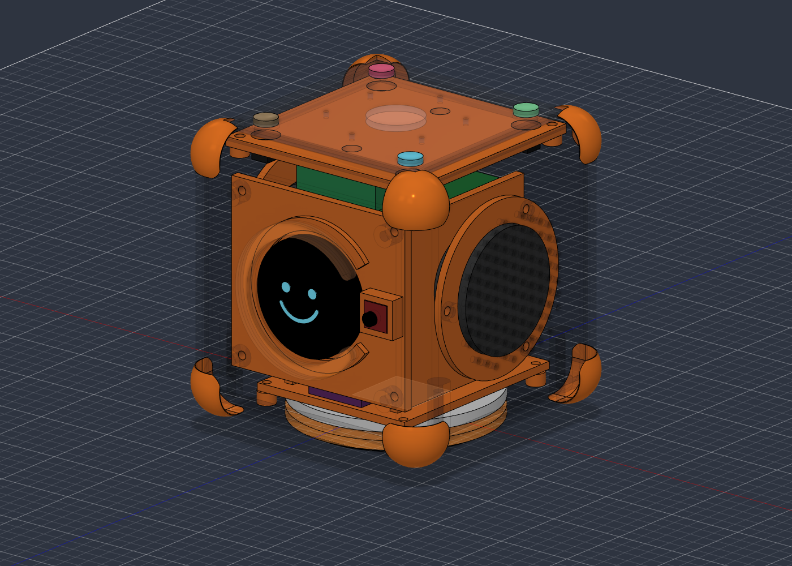

# C-kocka – elektronika (v0.2: kész modulokból)

> Cél: **minél több kész, kapható modul**, saját NYÁK nélkül, amennyire csak lehet. A modulok helyét a Fusion-modellben helyőrző testekkel ellenőriztük: **minden elfér a 90 mm-es kockában, ütközés nélkül, és mindenhol legalább 3 mm hely marad** a szereléshez (a falvastagságot 2,5 mm-re feltételezve; lásd [TERVEZESI_ELVEK.md](TERVEZESI_ELVEK.md)).
> Az árak a későbbi **költségoptimalizálás** lépésben kerülnek ide, beszállítói ajánlatok alapján. Az előző, ESP32-alapú terv: [ELEKTRONIKA_v0.1_ESP32.md](ELEKTRONIKA_v0.1_ESP32.md).

## Miért Raspberry Pi Zero 2 W (és nem ESP32)?
Az ESP32-S3-as tervhez a Bluetooth-kihangosítás miatt **egy második chip** és sok saját NYÁK kellett volna. A **Raspberry Pi Zero 2 W** ezzel szemben:
- **beépítve tud klasszikus Bluetooth-t** (A2DP zene + HFP kihangosító) és Wi-Fit → **nem kell második chip**,
- Linuxot futtat: a hangfeldolgozás, a kamerakép elemzése és a kijelző-animációk sokkal könnyebben megírhatók,
- köré **kész kiegészítő panelek** kaphatók (hang, akku), pontosan illeszkedő méretben (65 × 30 mm).

**Kockázat, amit a prototípuson ki kell próbálni:** a Bluetooth-kihangosító (HFP) a Pi-n működik, de a beállítása trükkös (PipeWire/BlueZ, a mikrofon útvonala). Ha nem válik be, tartalék: egy kész USB-s Bluetooth-hangmodul.

## Modulok
| # | Funkció | Kész modul | Méret | Megjegyzés |
|---|---|---|---|---|
| 1 | Agy, Wi-Fi, Bluetooth | **Raspberry Pi Zero 2 W** | 65 × 30 mm | 4 magos, klasszikus BT + BLE |
| 2 | Hang: 2 mikrofon + **sztereó** hangszóró-kimenet | **Adafruit Voice Bonnet** (WM8960 kodek) | 65 × 30 mm | a Pi tetejére dugható; **2 mikrofon** a tetőfuratok alatt. A gyártó már kivezette, de a C-kocka elméleti termék, ezért marad (döntés: 2026-11-16) |
| 3 | Akku + töltés + táp | **18650-es UPS panel Pi Zeróhoz** (pl. **Pi-Ener-lite**: USB-C, töltöttségmérő, RTC; vagy **Geekworm X306**) | Pi Zero méret + 18650 cella | rugós érintkezőkkel a Pi alá; kb. 2,5 A kimenet |
| 4 | Akku cella | **18650 Li-ion, védett, ~3000 mAh** | Ø 18,6 × 65 mm | TPU bölcsőben |
| 5 | Kerek kijelző | **1,28" kerek IPS, GC9A01, 240×240, kerek NYÁK-os változat** | Ø 37,5 mm | látható terület Ø 32,4 mm; SPI |
| 6 | Kamera | **mini „spy” kameramodul, OV5647, Pi Zero (22 pólusú, 0,5 mm) szalagkábellel**, pl. **Arducam B006603** vagy **Pi Supply Spy Camera** | kamerafej kb. 8,5 × 8,5 – 8,5 × 11,3 mm | a nagy Pi kameramodul nem fér el a kijelző mellett. Az Adafruit 1937 kábele nem Pi Zero-s; a Kailap JAL-KH3-C20B-1B (OV5640) DVP párhuzamos interfészű, ezért egyik sem jó |
| 7 | Hangszórók | 2× **VISATON K 36 WP, Ø36 mm, 8 Ω, 2 W** teljes sávú hangszóró | Ø 36 mm | a Voice Bonnet két kimenetére; a 40 mm-es helyett (döntés: 2026-11-16), a rögzítőgyűrű Ø36-ra módosul |
| 8 | Alsó fénygyűrű | **NeoPixel Ring 24** (WS2812) | **Ø 66 mm** – pont a modell gyűrűjének mérete | |
| 9 | C betű fénye | **S-alakú (síkban hajlítható) WS2812 LED-szalag**, 5 mm széles – a sima szalag síkban nem hajlik C alakba | kb. 110 mm (6–7 LED, 60 LED/m) | az előlapi tartó C bordáján fekszik, előtte az opál akril C |
| 10 | „Kisegítő” mikrovezérlő | **Seeed XIAO RP2040** | 21 × 17,5 mm | LED-ek, gombok, IMU, rezgés valós időben; USB-n vagy UART-on a Pi-hez |
| 11 | Mozgásérzékelő | **LSM6DS3TR-C** (vagy hasonló) I2C panel, STEMMA QT / Qwiic csatlakozóval | ~25 × 18 mm | dobás, rázás, tájolás |
| 12 | Rezgés | **DRV2605L** panel + kis rezgőmotor (LRA vagy ERM) | ~20 × 18 mm | „Ne zavarj” jelzések |
| 13 | Érintés | **AT42QT1010** érintőpanel + rézfólia elektróda a Ø18 mm-es műanyag betét alatt | kicsi | egy kimenet → XIAO |
| 14 | 4 gomb | 4× **6×6 mm-es nyomógomb** (kis NYÁK-modulon), SLA sapkák szárral és gallérral; az Andor-gomb tetején préselt fa betét | 6 × 6 mm | a XIAO bemeneteire |
| 15 | Rendszer-tároló | **microSD kártya, 32 GB, A1** | – | a Pi Zero 2 W operációs rendszeréhez és programjaihoz |
| 16 | Óraelem | **CR1220 gombelem** | Ø 12,5 mm | a UPS panel valós idejű órájához (RTC); a panelhez nem jár |

**Kábelezés:** az I2C eszközök (IMU, rezgés) **STEMMA QT / Qwiic** csatlakozós kábelekkel láncba fűzhetők, forrasztás nélkül. A többi rövid vezetékkel, egy kis prototípus-lapon gyűjtve.

## Elrendezés a kockában (Fusion: „Elektronika (vazlat)” komponens)
- **Felül:** Voice Bonnet (a mikrofonok a tetőfuratok alatt), alatta a Pi Zero 2 W.
- **Középen:** a UPS panel a 18650-es akkuval (a stack hosszában, elölről hátra).
- **Elöl:** a kerek kijelző, mellette a mini kamera a C nyílásában, a C mögött az S-alakú LED-szalag (a tartó C bordáján).
- **Oldalt:** a két 36 mm-es hangszóró, a rácsok mögött.
- **Alul:** a NeoPixel gyűrű, benne a XIAO RP2040, az IMU és a rezgéspanel.
- **A tető sarkaiban:** a 4 gomb kapcsolói; középen az érintőbetét alatt az elektróda.

Képek: [iso](assets/fusion/modulok_iso.png) · [elöl](assets/fusion/modulok_elol.png) · [oldal](assets/fusion/modulok_oldal.png)

## Ami a modellben változott emiatt
- A kocka **90 mm**-es lett (80 helyett), a tetőlap 72 mm, a gombok és a mikrofonfuratok ehhez igazodva kijjebb kerültek.
- A **kamerafurat** 22 mm-ről **26 mm-re** került a középtől (a C nyílásán belül maradt), így 3 mm hely marad a kerek kijelzőpanel mellett.
- Az alsó kis panelek (XIAO, IMU, rezgés) a LED-gyűrű fölé kerültek, hogy ne legyenek szorosan mellette.

## Eldöntött kérdések
- Bluetooth-kihangosító: **kell** → a Pi Zero 2 W beépítve tudja (nem kell második chip).
- Akku: **18650-es cella**, TPU bölcsőben.
- Mikrofonok: **kevesebb** → 2 db (a Voice Bonneten).
- Érintés a fém tetőn: **szigetelt műanyag betét** + elektróda.
- Hangulatfelismerés: **egyszerűsítve** (a Pi-n ez könnyebb is, mint az ESP32-n).
- Kiegészítő NYÁK-ok és nagyobb kocka megengedett (most nem kell).
- Bonyolult formájú belső alkatrészek: 3D nyomtatás vagy SLS.

## Kell-e hozzá MCP?
Most **nem**: saját NYÁK nem kell, a modulok mechanikai elhelyezése a már működő **Fusion MCP**-vel megy. Ha később mégis lesz egy kis „összekötő” panel, akkor a **KiCad** (ingyenes NYÁK-tervező) és egy **KiCad MCP** szerver lehet hasznos. Alkatrész-beszállítói (DigiKey, Mouser, LCSC) MCP-t a katalógusban nem találtunk; az árakat a költségoptimalizálásnál webes kereséssel gyűjtjük.

## Sorozatgyártásra (később)
Nagyobb darabszámnál a kész modulok helyett **egy saját NYÁK** olcsóbb lehet (pl. az ESP32-es v0.1 terv, vagy egy Raspberry Pi Compute Module). Ezt a költségoptimalizálás dönti el.

## Következő lépések
1. **Gyártási rajzok átbeszélése:** melyik alkatrész miből, hogyan készül (vágás, marás, nyomtatás).
2. **Költségoptimalizálás:** árak, alternatívák, mi hagyható el vagy oldható meg olcsóbban.
3. Prototípus: a modulok beszerzése és összerakása.
