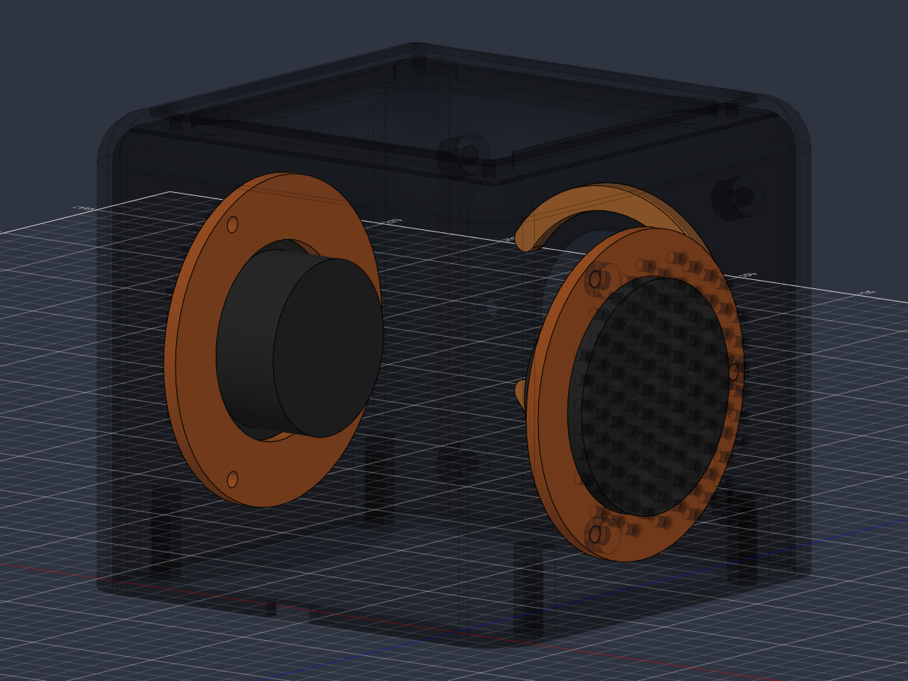
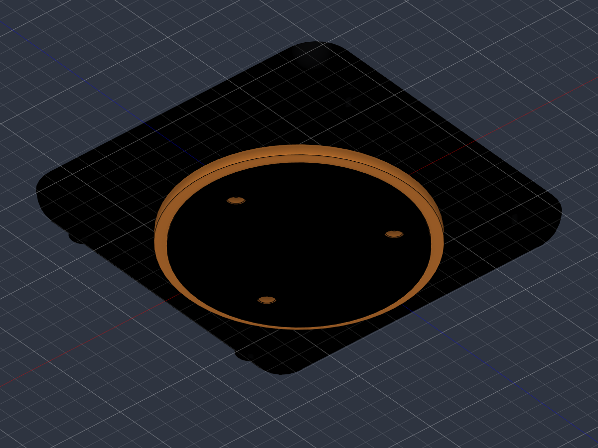
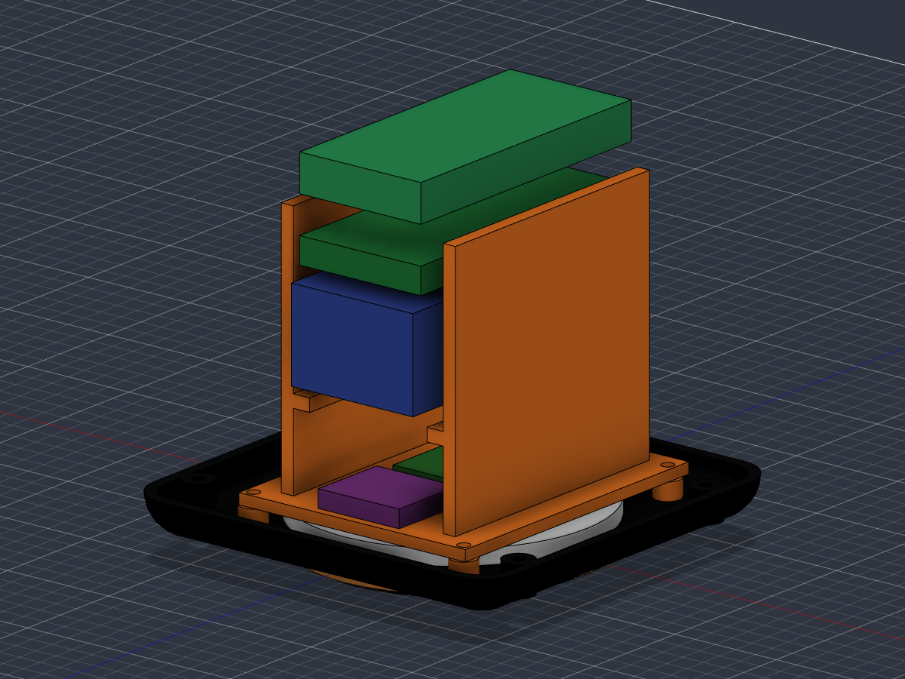
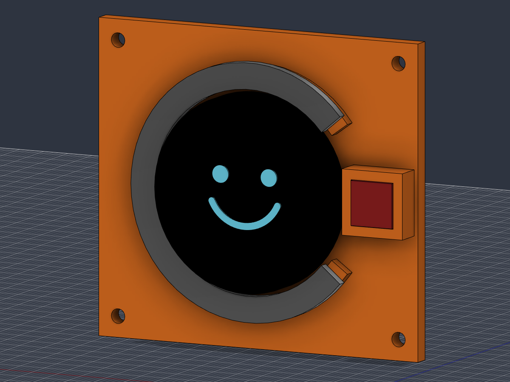
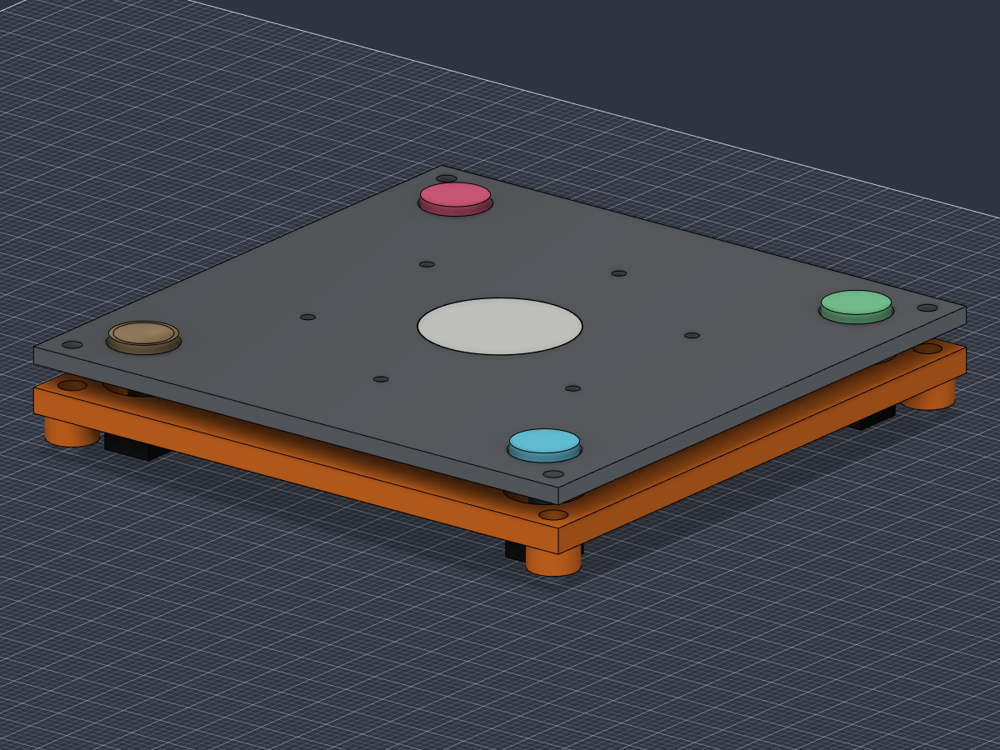
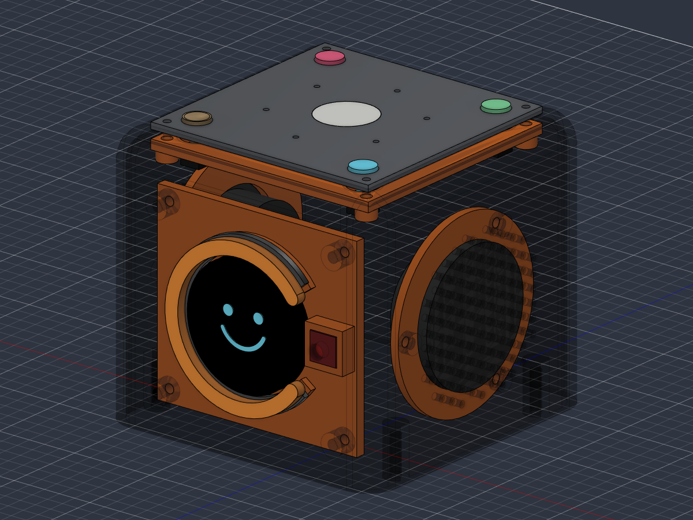
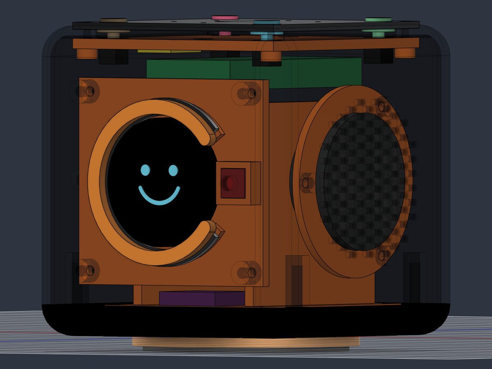
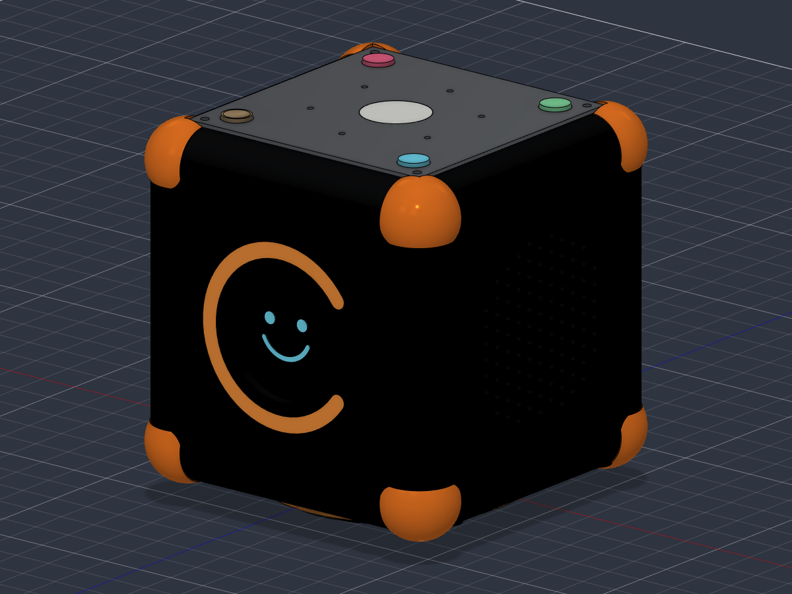

# C-kocka – szerelési útmutató (90 mm-es prototípus)

A kocka **négy egységből** áll, amiket külön lehet összerakni és kipróbálni:

| Egység | Mi van benne | Hogyan kapcsolódik |
|---|---|---|
| **Ház** (SLS PA12) | C fénycsatorna, 1 hangszóró | – |
| **Tálca + szán** | akku, Pi, ReSpeaker hangpanel, XIAO, IMU, rezgőmodul, USB-C, LED-gyűrű, diffúzor | alulról tolható be, 4 csavarral |
| **Előlapi egység** | kerek kijelző, kamera, C LED-szalag | 4 csavarral a ház elejére |
| **Tetőegység** | tetőtartó a gombmodulokkal és az érintőelektródával + alu tetőlap a sapkákkal | a tetőtartó alulról, a tetőlap felülről; a 4 csavar a ház peremén át fogja össze őket |

**Becsült idő:** kb. 1,5 óra, plusz **24 óra** a szilikon kötése (ezért az 1. lépés az első).

---

## Mi kell hozzá

### Kötőelemek
| Db | Elem | Hová |
|---|---|---|
| 30 | **M2,5 menetes betét** (beolvasztós, Ø3,6-os furatba, 4 mm hosszú) | tetőtartó 4, ház elöl 4, ház a tálcához 4, ház a hangszóróhoz 3, tálca a diffúzorhoz 3, szán lábai 4, szán jobb sín (IMU 2 + NeoDriver 4) 6, USB-C szorítólap 2 |
| **13** | **M2,5×8 süllyesztett fejű** (ISO 10642 / DIN 7991) | tetőlap → tetőtartó 4, ház hátfala (kívülről) → USB-C szorítólap 2, diffúzor → tálca 3, tálca → szán lábai (alulról) 4 |
| **21** | **M2,5×6 hengeres fejű** (ISO 4762 / DIN 912) | előlapi tartó → ház 4, hangszóró-rögzítő gyűrű → ház 3, IMU → szán jobb sín 2, NeoDriver → szán jobb sín 4, Pi + ReSpeaker távtartói 8 |
| **4** | **M2,5×14 hengeres fejű** | tálca → ház (alulról) |
| 4 | M2,5 távtartó, 11 mm, anya-anya | Pi + ReSpeaker hangpanel (a csavarjai a fenti M2,5×6-osok) |

**3 féle csavar** (2026-11-17, KOLTSEGOPTIMALIZALAS.md M1): így nem lehet összekeverni őket. A ×8-as süllyesztett csavarhoz a diffúzornál és a szánlábaknál mélyebb a betétfurat (diffúzor: a tálca oszlopa 6,3 mm magas, a furat 5,6 mm; szánláb: 5 mm). A modellben minden csavar szára csak furatban fut, sehol nem ér ki és nem ütközik.

A csavarhosszak a modellből számolt **javaslatok**, az első próbaszerelésnél ellenőrizni kell őket.

### Anyagok és szerszámok
- **Semleges (neutrális) térhálósodású szilikon**, víztiszta vagy fehér. **Ecetszagú (acetoxi) szilikont ne használj**, mert repeszti az akrilt, és korrodálja az elektronikát.
- Izopropil-alkohol a zsírtalanításhoz.
- Ragasztó a gumisarkokhoz (pl. kétkomponensű, vagy TPU-hoz való pillanatragasztó).
- Pákahegy menetes betéthez (vagy sima páka kb. 220 °C-on), imbuszkulcs-készlet (1,5 / 2 mm), csipesz.

### Gyártott alkatrészek (fájlok)
- **SLS PA12:** ház, alsó tálca → `3d/nyomtatas/SLS_PA12/`
- **FDM PETG:** szán, tetőtartó, előlapi tartó, 1 hangszóró-rögzítő → `3d/nyomtatas/FDM_PETG/`
- **SLA gyanta:** 4 gombsapka (az Andor-alap is) → `3d/nyomtatas/SLA_gyanta/`
- **FDM TPU 95A:** 8 gumisarok → `3d/nyomtatas/FDM_TPU95A/`
- **Lézer / CNC (DXF):** alu tetőlap, opál C, érintőbetét, diffúzor, Andor fa betét (a gumitalp helyett 2026-11-17 óta 4 kész öntapadós gumiláb) → `dxf/vagas/` (olvasd el az `OLVASSEL.txt`-t is: süllyesztések, hézagok)

---

## 0. Előkészítés: menetes betétek
Minden nyomtatott alkatrészbe olvaszd be az M2,5-ös betéteket (a fenti táblázat szerint 30 db). A betét felülete egy síkba kerüljön a felülettel, és ne álljon ferdén – a pákát függőlegesen tartsd, lassan nyomd.

## 1. Ház: C fénycsatorna, érintőbetét és hangszórók

1. Zsírtalanítsd a C horony belső peremét és az opál C-t.
2. Tedd be a **C-t kívülről** a horonyba: elöl egy síkba kerül a fallal, belül 0,5 mm-rel kilóg.
3. **Belülről** húzz körbe egy vékony szilikoncsíkot a C kilógó része és a fal közé. Kívül ne kerüljön szilikon a résbe.
4. Ugyanígy: az **érintőbetétet** tedd az alu tetőlap Ø18-as furatába (a tetőlap felső síkjával egy síkba), és alulról szilikonozd körbe.
5. **Hangszóró:** a 36 mm-es hangszórót (VISATON K 36 WP) a rács mögé tedd, a PETG gyűrűvel szorítsd oda, 3 db M2,5×6 csavarral. **Csak a BAL rács mögött** (2026-11-17 óta mono; a B döntés óta a bal oldalon, mert a jobb oldalon a Pi–XIAO USB-dugónak kell a hely); a jobb rács szellőző marad. *(Az ábrán még két hangszóró látszik.)*
6. **USB-C:** a hosszabbító aljzatát belülről told a hátfal nyílásába (9,4 × 3,6 mm, 18 mm-rel az alj fölött), a fülét fogd a fal és a nyomtatott **USB-C szorítólap** közé, és kívülről 2 db M2,5×8 süllyesztett csavarral húzd a lap betéteibe. A hosszabbító a házban marad; a dugós vége szabadon lóg (10–15 cm).
7. Hagyd **24 órát** kötni (ez idő alatt jöhet a többi egység).

## 2. Tálca: diffúzor és gumilábak

1. Az opál diffúzort tedd a tálca aljára, a süllyesztett oldala nézzen kifelé.
2. Rögzítsd 3 db M2,5×8 süllyesztett fejű csavarral.
3. A 4 öntapadós gumilábat zsírtalanítás után ragaszd a tálca aljára, a diffúzorcsavarok közé, egyenletesen elosztva.

## 3. Szán: elektronika

1. A **NeoPixel gyűrűt** a tálca fényablaka fölé tedd (a LED-ek lefelé, a diffúzor felé nézzenek).
2. A **szánt** tedd a tálcára, és alulról 4 db M2,5×8 süllyesztett csavarral húzd a lábaiba.
3. A szán aljára: **XIAO RP2040** (az USB-C portja jobbra, a jobb sín felé néz) és a **rezgőmotor-modul**. A **NeoDriver** függőlegesen a **jobb sín külső oldalára**, az IMU elé kerül (alkatrész-oldal kifelé, sorkapcsok felül), 4 db M2,5×6 csavarral a sín betéteibe. Az **IMU** függőlegesen a **jobb sín külső oldalára** kerül (alkatrész-oldal kifelé, a rögzítőfuratos él felül), 2 db M2,5×6 csavarral a sín betéteibe. A Qwiic → Dupont kábelt (Adafruit 4397, 150 mm) a sínbe vágott résen (y 17…24, z −5…1) át a XIAO tüskéire (3V3, GND, D4 = SDA, D5 = SCL). Az út kb. 40 mm, a kb. 110 mm-es ráhagyást a jobb sín külső oldalán, az IMU fölött (y 31…46, z −30…−10) laza hurokban, kábelkötegelővel a sín réséhez fogva kell elvezetni – ragasztás nélkül.
4. A szán polcaira: **UPS panel + 18650 akku**, felette a **Raspberry Pi Zero 2 W**, rá 11 mm-es távtartókkal a **ReSpeaker hangpanel**.
5. Kösd be a kábeleket: gyűrű → XIAO, IMU és rezgés → XIAO (I²C), **XIAO → Pi: rövid OTG-kábel, mindkét végén 90°-os dugóval** – a Pi micro-USB (OTG) portjába egy **előre forduló micro-B** dugó a jobb sín ablakán át, a XIAO-ba egy **felfelé forduló USB-C** dugó (a feje a fedélzet kivágásába lóg). A kábel a jobb sín külső oldalán előre, a sín vége előtt (a NeoDriver előtt) le, majd a fedélzet fölött a XIAO-hoz fut. **Kijelző → XIAO:** 8 eres Dupont-kábel (SCK, MOSI, DC, CS → GND, RST és BL → 3,3 V, 3,3 V, GND) az előlapi tartó középső nyílásán át, a tartó hátlapja és a UPS eleje között (itt csak 3 mm van: a vezetékeket laposan, egymás mellett vezesd), a UPS alatt a XIAO-ig. UPS → Pi táp. (Az USB-C hosszabbító a házban van, a 8. lépésben dugod be.)

## 4. Előlapi egység

1. Az **S-alakú LED-szalagot** fektesd a tartó C bordájára (a LED-ek előre nézzenek), és a végeit rögzítsd a szalag öntapadós hátoldalával.
2. A **kerek kijelzőt** tedd a 3 távtartóra, a kábelét a középső nyíláson vezesd hátra.
3. A **mini kamerát** nyomd a keretébe (a C nyílásánál), a szalagkábele hátra menjen.

## 5. Tetőegység előkészítése

1. A 4 gombmodult (6×6-os nyomógomb) a **tetőtartó** aljára rögzítsd, a nyomógomb a tartó Ø9-es furata alá kerüljön.
2. Az érintőelektródát (öntapadós rézfólia) a tetőtartó közepére ragaszd, az érintőbetét alá eső helyre. A vezetéke a XIAO érintő-bemenetére megy (az 1 MΩ-os lehúzó ellenállás a gombok prototípus-lapján van).
3. Az **Andor fa betétet** nyomd az Andor-sapka tetején lévő zsebbe (szoros illesztés, ragasztás nélkül).
4. A gombokat és az érintést kösd be a XIAO felé menő kábelbe.
5. A tetőtartó és a tetőlap **külön marad**, csak a házban kerülnek össze (7. lépés): a 72 mm-es tetőtartó nem fér át a 60 mm-es tetőnyíláson.

## 6. Próba a házon kívül
Mielőtt bármi a házba kerülne: csatlakoztass mindent, és nézd meg, hogy működik-e a kijelző, a kamera, a hang, a mikrofonok, a gombok, az érintés, a LED-ek és a töltés. Így később nem kell szétszedni.

## 7. Előlapi egység és tetőegység a házba

1. Az **előlapi egységet** alulról tedd be, a ház elejéhez, és belülről 4 db M2,5×6 csavarral rögzítsd.
2. A **tetőtartót** alulról told fel a ház pereme alá, és tartsd ott.
3. A 4 **gombsapkát alulról** dugd át az alu tetőlap furatain (a gallér a tetőlap alá kerül).
4. A tetőlapot a sapkákkal együtt tedd a helyére **felülről**: a gallérok beleülnek a ház peremének kivágásaiba.
5. 4 db M2,5×8 süllyesztett fejű csavar a tetőlapon és a ház peremén át a tetőtartó betéteibe: ez fogja össze a tetőlapot, a peremet és a tetőtartót.

## 8. Szán alulról

1. Csatlakoztasd a kábeleket: előlapi egység, tetőegység, hangszóró, és a ház hátfalán lévő **USB-C hosszabbító dugóját a Pi-Ener-lite USB-C aljzatába**.
2. Tolj be **alulról** a tálcát a szánnal együtt (vigyázz, hogy kábel ne csípődjön be).
3. Rögzítsd 4 db M2,5×14 csavarral alulról a ház oszlopaiba.

## 9. Gumisarkok

Ragaszd fel a 8 narancs gumisarkot (zsírtalanítás után). Ez az egyetlen igazi ragasztás – a tálca csavarjai úgy vannak elhelyezve, hogy a sarkok ne takarják el őket.

---

## Szétszerelés (szerviz)
- **Akku / elektronika:** 4 csavar alul → a tálcát csak 2–3 cm-re húzd ki, és **dugd le az USB-C hosszabbítót a Pi-Ener-lite-ról** (a hosszabbító a ház hátfalán marad); utána a tálca a szánnal együtt kicsúszik.
- **Gombsapkák, tetőlap:** 4 csavar a tetőn → a tetőlap a sapkákkal leemelhető. A tetőtartó (gombmodulok, érintés) ilyenkor leereszkedik a hangpanelre; kivenni a tálca kihúzása után, alulról lehet.
- **Kijelző / kamera:** a tető levétele után az előlapi egység 4 csavarja.
- **C vagy érintőbetét csere:** a szilikont belülről késsel ki lehet vágni.

**IMU (2026-11-17 óta):** függőlegesen a szán **jobb sínjének külső oldalán** (a jobb hangszóró felőli oldalon). A NYÁK síkja függőleges, az alkatrész-oldal kifelé, jobbra néz (+X); a hosszanti él vízszintes, előre-hátra fut; a két rögzítőfuratos él felül van. A panel saját tengelyei a kockához képest (Y fel, eleje +Z, jobb +X): **panel X → hátra (−Z), panel Y → fel (+Y), panel Z → jobbra (+X)**. Ez a panel éleiből és a gyártói rajzból adódik; a chip tengelyjelölését a megvásárolt panel szitanyomatán ellenőrizni. **A firmware-ben (`firmware/xiao/code.py`, a `claude/confident-wilson-a057bb` ágon) a tengelyeket át kell számolni** (dobás, rázás, tájolás) – a firmware-t ez a változtatás nem módosította.

**NeoDriver (Adafruit 5766, 2026-11-17):** függőlegesen a szán **jobb sínjének külső oldalán, az IMU előtt** (a bal oldalon a hangszóró miatt nem fér el). A gyártói rajz szerint 25,4 × 25,4 mm, 4 db Ø2,5 furat; alkatrész-oldal kifelé (jobbra), a sorkapcsok felül (a LED-vezetékek felfelé lépnek ki, fölöttük kb. 9 mm szabad hely van az ívhez), a Qwiic csatlakozók előre és hátra néznek. 4 db M2,5×6 hengeres fejű csavar a sínbe olvasztott betétekbe. A Qwiic lánc az IMU második portjáról egy rövid QT–QT kábellel jön, a jobb és a bal sín résén át (a NeoDriver a jobb sínen az IMU mellett van, a QT–QT kábel rövid). A bal sín korábbi NeoDriver-csavaroszlopai és rése a szánon maradtak, betét nélkül, nem használtak.

## Még pontosítandó (a valódi alkatrészek alapján)
- a modulok rögzítőfuratai a szánon (Pi, ReSpeaker, UPS, XIAO; az IMU-é a gyártói rajzból kész) – a pontos furatképet a megvásárolt panelekről kell levenni,
- a 4 gombmodul rögzítése a tetőtartó alján, és a kijelző csavarjai,
- a kábelek hossza és a csatlakozók típusa (JST-SH / JST-PH).
