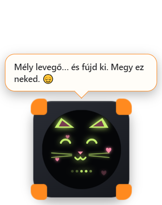

# Matka – a C-kocka cicája, kis asztali segéd Windowsra és Macre

A C-kocka „cat mode”-ja kiköltözött az asztalodra. **Matka** egy kis macskafejes kocka a képernyő sarkában:
figyel, dorombol, és ha nehéz a meló, egy kattintásra lelket önt beléd. **Magától nem szól és nem nyávog**,
hogy ne vonja el a figyelmedet a munkáról.



## Letöltés – a barátaidnak is
- **Windows 10/11:** [⬇ Matka.exe](https://github.com/Zollthunder/Ckoc/releases/latest/download/Matka.exe) (~75 MB). Telepíteni nem kell, dupla kattintással indul.
- **Mac (Intel és Apple Silicon):** [⬇ Matka-mac.dmg](https://github.com/Zollthunder/Ckoc/releases/latest/download/Matka-mac.dmg). Nyisd meg, és húzd a Matkát az Alkalmazások mappába.

Ha azt szeretnéd, hogy mindig elinduljon, a menüben kapcsold be az **Indítás a Windowszal** (Macen: **Indítás bejelentkezéskor**) pontot.

**Első indításkor a rendszer figyelmeztet**, mert a program nincs digitálisan aláírva (ahhoz fizetős tanúsítvány kellene, egy ingyenes hobbiprojektnél ez nem éri meg). Egyszer kell átengedni:
- **Windows:** „A Windows megvédte a számítógépet” → **További információ** → **Futtatás mindenképp**.
- **Mac:** Ctrl+kattintás a Matkán → **Megnyitás** → **Megnyitás**. macOS 15-től: **Rendszerbeállítások → Adatvédelem és biztonság → Megnyitás mindenképp**. Ha azt írja, hogy „sérült”, a Terminálban: `xattr -cr /Applications/Matka.app` (lásd [KIADAS.md](KIADAS.md)).

> A Mac-változatot a GitHub építi (`.github/workflows/matka.yml`), Macen még nem próbáltuk ki – ha furcsán viselkedik, szólj!

## Forrásból futtatás (fejlesztőknek)
Kell hozzá a [Node.js](https://nodejs.org). A `sidekick` mappában:
```bash
npm install
npm run parancsikon
```
Az első parancs letölti az Electront, a második egy **„Matka”** parancsikont tesz az Asztalra. Parancsikon nélkül: `npm start`.

Az exe elkészítése: `npm run icon` (az ikon az arcból), majd `npm run dist` → `release/Matka.exe`.
Kiadás (Windows + Mac egyszerre): egy `matka-v…` tag feltöltése, pl. `git tag matka-v0.2.0 && git push origin matka-v0.2.0` – a GitHub Actions megépíti mindkettőt, és feltölti a Release-be a [KIADAS.md](KIADAS.md) szövegével.
A gép régi Node-ja miatt a csomagoló az Electron saját Node-jával fut ([build/dist.js](build/dist.js)).

## Használat
| Mit csinálsz | Mit csinál a cica |
|---|---|
| **Kattintasz rá** | dorombol, szívecskéket küld, és mond egy **bíztató mondatot** 💪 |
| **Dupla kattintás** vagy **Ctrl+Alt+K** (Mac: **⌘⌥K**) | felugrik a **kereső** 🔎 (lásd lent) |
| **Ctrl+Alt+B** (Mac: **⌘⌥B**) | bíztatás bárhonnan, akkor is, ha épp más ablakban vagy |
| **Föléviszed az egeret** | hegyezi a fülét |
| **Megfogod és húzod** | arrébb megy; a helyét megjegyzi |
| **Jobb gomb** rajta, vagy a tálcaikon (Macen: Ctrl+kattintás, vagy a menüsor-ikon) | menü |
| **Nem nyúlsz a géphez 5 percig** | elszunyókál (zzz); ha visszajössz, csendben felébred |

A szeme mindig az egérmutatót követi, és néha pislog.

### Kereső
Írd be, mit keresel, és nyomj Entert – a böngésződben nyílik meg.

| Beírod | Ahol keres |
|---|---|
| `macska kenyér` | Google (a menüben Bingre vagy DuckDuckGóra váltható) |
| `yt lofi zene` | YouTube |
| `w Rubik-kocka` | Wikipédia |
| `map pizzéria Budapest` | Google Térkép |
| `12*7+3`, `15% * 200`, `2^10` | **kiszámolja** maga, a buborékban |
| egy webcím (`https://…`) | megnyitja |

Az Esc bezárja a keresőt.

### Menü (jobb gomb)
- **💪 Bátoríts!** – ugyanaz, mint a kattintás
- **🔇 Néma mód** – semmilyen hangot nem ad ki (a buborékok maradnak)
- **Szünet-emlékeztető** – 30 / 50 / 60 / 90 percenként szól, hogy nyújtózz vagy igyál vizet. *Alapból kikapcsolva.*
- **Cuki üzenetek időnként** – 20–40 percenként ír egy kedves mondatot. *Alapból kikapcsolva.*
- **Keresőmotor** – Google, Bing vagy DuckDuckGo
- **Indítás a Windowszal** – bekapcsoláskor magától elindul
- **Vissza a sarokba** – ha elkeveredett
- **❓ Hogyan használd?** – rövid súgó a buborékban
- **Kilépés**

A beállítások itt vannak: Windowson `%APPDATA%\Matka\settings.json`, Macen `~/Library/Application Support/Matka/settings.json`.

## Bemutató mód
`npm run demo` – sorban végigmegy mindenen (bíztatás, cuki üzenet, emlékeztető, súgó, kereső, alvás, ébredés), hogy egyben lásd.

## Hogyan működik
- [main.js](main.js) – az Electron fő folyamata: átlátszó, keret nélküli, mindig felül lévő ablak; tálcaikon és menü; az egérmutató követése; a tétlenség figyelése; a keresés (csak ismert keresőoldalakra, URL-kódolt szöveggel).
- [cat.js](cat.js) – az arc rajzolása (ugyanaz a macskaarc, mint a XIAO-n és a webes szimulátorban), a hangok (kódból generált miaú és dorombolás, hangfájl nélkül), a buborék, a számológép (`eval` nélkül).
- [preload.js](preload.js) – a kettő közötti szűk híd: az ablak csak a felsorolt üzeneteket küldheti.

Az internetre csak akkor nyúl, ha keresel – akkor is a böngésződ nyitja meg az oldalt. Adatot nem gyűjt és nem küld.
